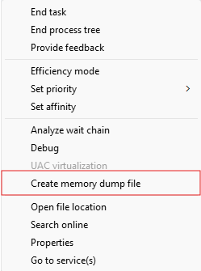

# getting memory on windows is as simple as having a debugger installed.

Firstly start a program as admin

```bash
# .\windowsExample.exe
H9t2LmC1SmvtyheQJ4ZjplL7pT8ClHH57qyRR+pbGuk=

#
```

Then go into a non-admin shell and try to do a `procdump` (this is completely possible when not run as admin and by the same user).

```bash
$ procdump 20008

ProcDump v11.0 - Sysinternals process dump utility
Copyright (C) 2009-2022 Mark Russinovich and Andrew Richards
Sysinternals - www.sysinternals.com

Error opening windowsExample.exe (20008):
Access is denied. (0x00000005, 5)

$
```

Then go into task manager and grab a dump anyways



From here we can just look through the dump for the key!


## For Linux


obviously we have a debugger capability: i.e. `gdb`

we can also go through /proc/[pid]/mem and just read till we find something: https://linux.die.net/man/5/proc


## for virtualization

This gets even worse where the attack can come outside of the VM and isn't protected by anything except for maybe confidential compute.
